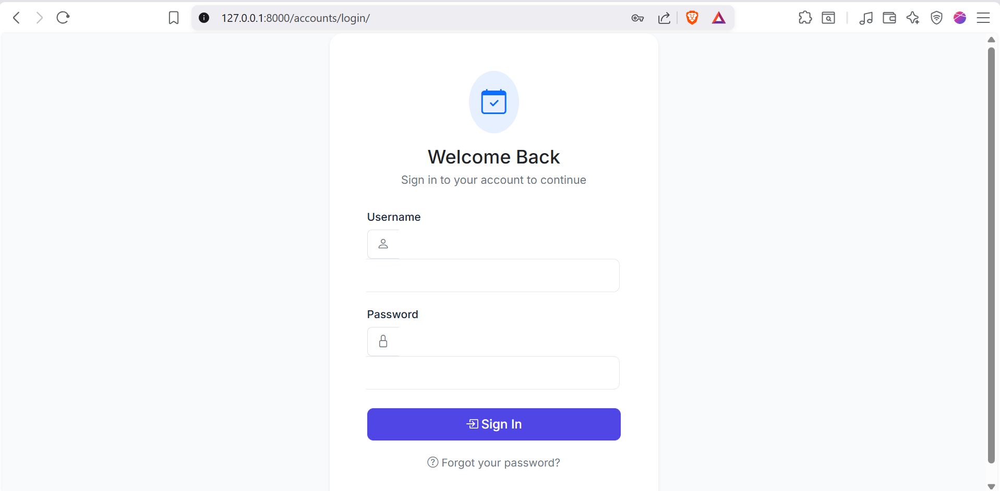
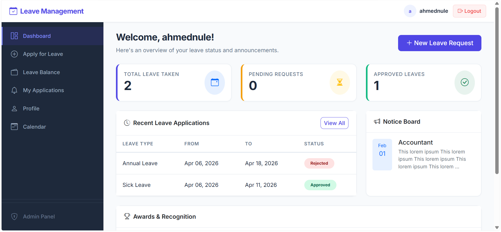
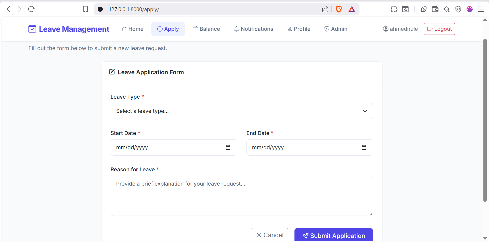
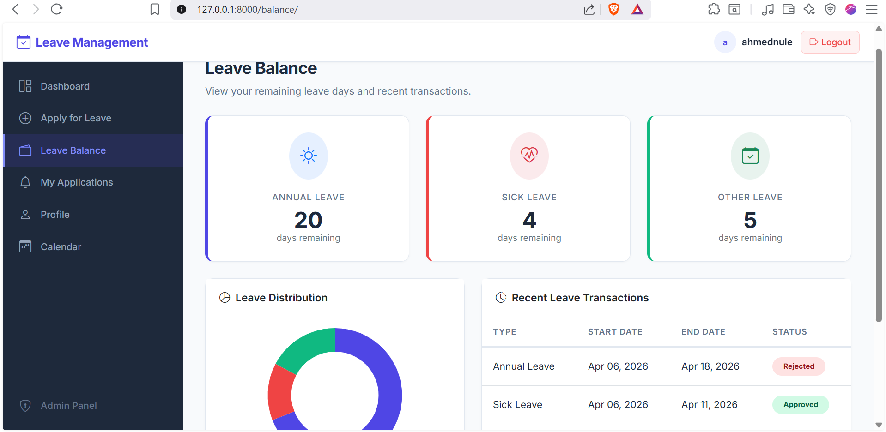
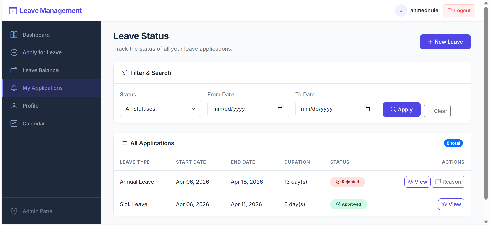
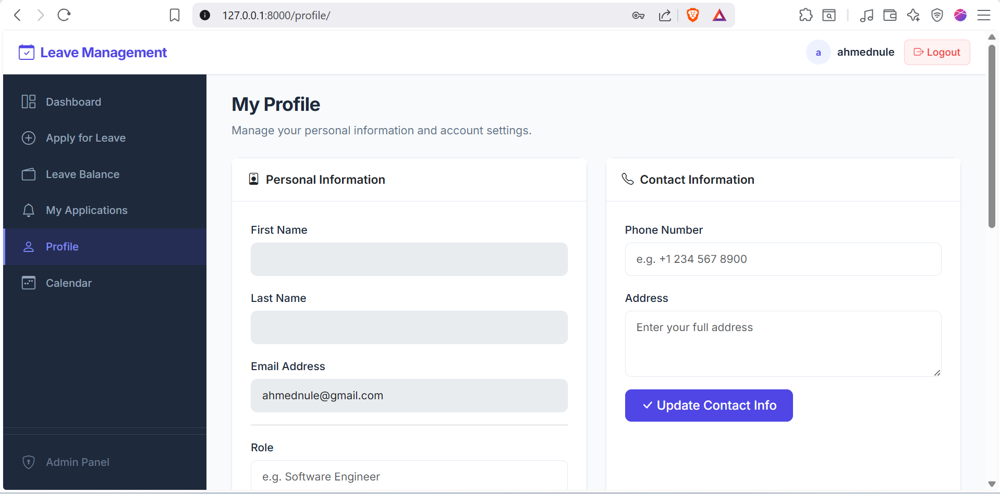
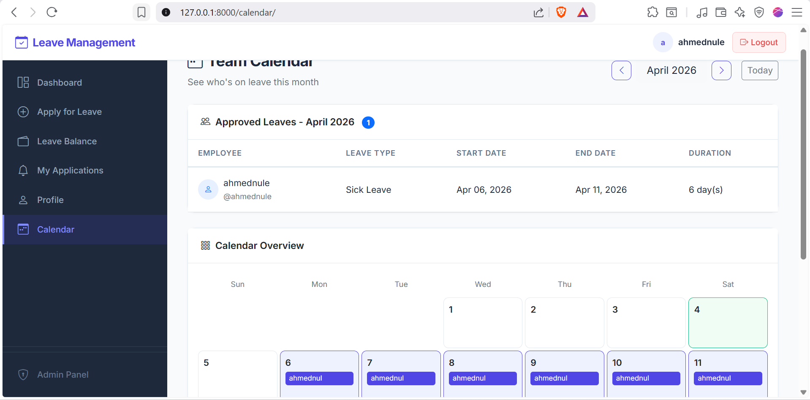
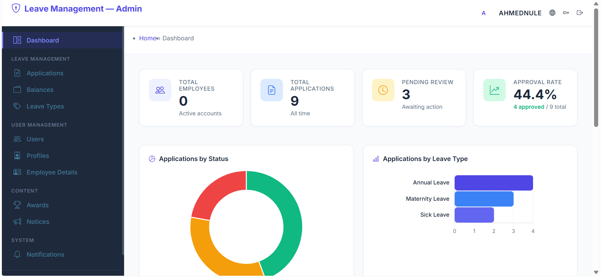
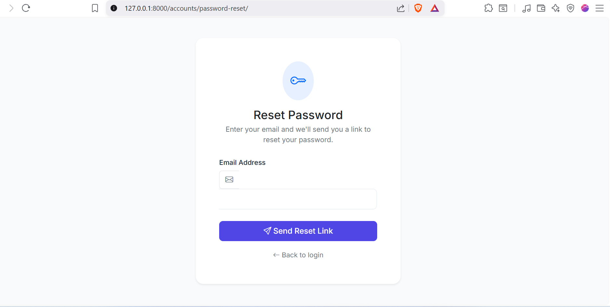

# Sistema de Gestión de Licencias en Línea

Una aplicación web profesional y completa, desarrollada con Django, para gestionar solicitudes de licencias de empleados: desde la solicitud de licencias hasta el seguimiento de aprobaciones, todo a través de una interfaz de usuario moderna y adaptable con un panel de administración dedicado.

## Tabla de Contenidos

- [Capturas de pantalla](#screenshots)
- [Características](#features)
- [Primeros pasos](#getting-started)
- [Instalación](#installation)
- [Uso](#usage)
- [Configuración de correo electrónico](#email-configuration)
- [Contribuciones](#contributing)
- [Contacto](#contact)
- [Licencia](#license)

## Capturas de pantalla

### Inicio de sesión


### Panel de usuario


### Solicitar licencia


### Saldo de licencias


### Mis solicitudes


### Perfil


### Calendario del equipo


### Panel de administración


### Restablecimiento de contraseña


## Características

### Para empleados

- **Autenticación de usuario**: Inicio y cierre de sesión seguros, y gestión de contraseñas con restablecimiento basado en correo electrónico.
- **Registro de usuario**: Los nuevos empleados pueden crear cuentas con información de rol y departamento.
- **Solicitud de licencia**: Solicite licencias indicando tipo, rango de fechas y motivo. Incluye prevención de duplicados/superposiciones.
- **Saldo de licencias**: Consulte sus días restantes de licencias anuales, por enfermedad y otras, con deducción automática al aprobarse.
- **Seguimiento del estado**: Rastreje todas sus solicitudes de licencia con etiquetas de estado (Pendiente, Aprobado, Rechazado, Cancelado).
- **Vista de detalles**: Página dedicada con todos los detalles de cada solicitud de licencia.
- **Cancelar solicitudes pendientes**: Cancle sus propias solicitudes pendientes antes de que se procesen.
- **Gestión del perfil**: Actualice su rol, departamento, información de contacto y contraseña.
- **Navegación lateral**: Barra lateral izquierda profesional para acceder rápidamente a todas las páginas.

### Para administradores

- **Panel analítico de administración**: Vista general con tarjetas de estadísticas (empleados totales, solicitudes, pendientes, tasa de aprobación), gráfico de anillo (por estado), gráfico de barras (por tipo de licencia) y tabla de solicitudes recientes.
- **Interfaz de administración profesional**: Diseño personalizado con barra lateral que coincide con la del portal de usuario.
- **Gestión de licencias**: Consulte, apruebe o rechace todas las solicitudes de licencia con registro de auditoría.
- **Acciones masivas**: Aprove o rechace múltiples solicitudes de licencia a la vez desde la vista de lista.
- **Motivo del rechazo**: Campo obligatorio de motivo al rechazar, con notificación dentro de la aplicación para el empleado.
- **Deducción automática del saldo**: Los días de licencia se descuentan automáticamente de los saldos de los empleados al aprobarse.
- **Notificaciones por correo**: Los empleados reciben notificaciones cuando su licencia es aprobada o rechazada.
- **Calendario del equipo**: Calendario mensual visual que muestra de un vistazo quién tiene licencia aprobada.
- **Gestión de tipos de licencia**: Agregue, edite o elimine categorías de tipos de licencia.
- **Gestión de usuarios**: CRUD completo para usuarios, perfiles y detalles de empleados a través del admin de Django.
- **Registro de auditoría**: Registra quién aprobó/rechazó cada licencia y cuándo.
- **Búsqueda y filtrado**: Busque por nombre/usuario del empleado, filtre por estado y rango de fechas.
- **Paginación**: Gestione listas extensas con paginación integrada.

### Características del sistema

- **Interfaz profesional**: Diseño moderno y adaptable con fuente Inter, Bootstrap 5 e iconos de Bootstrap.
- **Diseño coherente**: Disposición de barra lateral oscura uniforme para el portal de usuario y el panel de administración.
- **Diseño adaptable**: Funciona en escritorio y dispositivos móviles con barra lateral colapsable.
- **Retroalimentación en tiempo real**: Mensajes de éxito y error para todas las acciones.
- **Licencia MIT**: Código abierto y libre de usar.

## Primeros pasos

Siga estos pasos para configurar la aplicación en su máquina local.

### Requisitos previos

- **Python 3.x**
- **Django 5.x**
- **SQLite** (predeterminado, incluido)

### Instalación

#### Paso 1: Clonar el repositorio

```bash
git clone https://github.com/ahmednule/Online_leave_Management_system.git
cd Online_leave_Management_system
```

#### Paso 2: Configurar un entorno virtual

**Para Windows:**
```bash
python -m venv venv
venv\Scripts\activate
```

**Para Linux/Mac:**
```bash
python3 -m venv venv
source venv/bin/activate
```

#### Paso 3: Instalar dependencias

```bash
pip install -r requirements.txt
```

#### Paso 4: Aplicar migraciones

```bash
python manage.py migrate
```

#### Paso 5: Crear un usuario de administrador

```bash
python manage.py createsuperuser
```

#### Paso 6: Ejecutar el servidor de desarrollo

```bash
python manage.py runserver
```

#### Paso 7: Acceder a la aplicación

Abra su navegador y acceda a [http://127.0.0.1:8000/](http://127.0.0.1:8000/)

---

## Uso

### Rutas URL

| URL | Descripción |
|-----|-------------|
| `/` | Panel de control — vista general, estadísticas, licencias recientes, avisos |
| `/apply/` | Enviar una nueva solicitud de licencia |
| `/balance/` | Consultar su saldo de licencias |
| `/notifications/` | Ver todas sus solicitudes de licencia con filtros |
| `/profile/` | Gestionar su perfil y cambiar contraseña |
| `/calendar/` | Calendario de licencias del equipo (acceso de administrador) |
| `/accounts/login/` | Página de inicio de sesión (redirige a superusuarios a `/admin/`) |
| `/accounts/register/` | Registro de empleados |
| `/accounts/password-reset/` | Solicitar correo de restablecimiento de contraseña |
| `/admin/` | Panel de administración — panel analítico, gestión de licencias, gestión de usuarios |

### Flujo de autenticación

- **Usuarios regulares** inician sesión y son redirigidos al **Panel de control** (`/`).
- **Superusuarios** inician sesión y son redirigidos al **Panel de administración** (`/admin/`).
- Después del cierre de sesión, todos los usuarios son redirigidos a la página de inicio de sesión.

### Panel de administración

El panel de administración en `/admin/` incluye:

1. **Panel analítico** — Tarjetas de estadísticas, gráficos y solicitudes recientes.
2. **Gestión de licencias** — Solicitudes, Saldos, Tipos de licencia (vía barra lateral).
3. **Gestión de usuarios** — Usuarios, Perfiles, Detalles de empleados (vía barra lateral).
4. **Contenido** — Premios, Avisos (vía barra lateral).
5. **Notificaciones** — Notificaciones del sistema (vía barra lateral).

### Creación de tipos de licencia

Como administrador, vaya a `/admin/` y navegue a **Gestión de licencias > Tipos de licencia** para agregar nuevas categorías (por ejemplo, Licencia anual, Licencia por enfermedad, Licencia de maternidad, Licencia de paternidad).

### Configuración de saldos de licencia

Los nuevos usuarios obtienen automáticamente un saldo predeterminado (20 días anuales, 10 por enfermedad, 5 de otros). Los administradores pueden modificar los saldos a través del panel de administración en `/admin/`.

## Configuración de correo electrónico

El sistema utiliza un backend de correo por consola de forma predeterminada (los correos se imprimen en la terminal). Para producción, actualice `settings.py`:

```python
EMAIL_BACKEND = 'django.core.mail.backends.smtp.EmailBackend'
EMAIL_HOST = 'smtp.yourprovider.com'
EMAIL_PORT = 587
EMAIL_USE_TLS = True
EMAIL_HOST_USER = 'your-email@example.com'
EMAIL_HOST_PASSWORD = 'your-password'
DEFAULT_FROM_EMAIL = 'Leave System <noreply@example.com>'
```

## Contribuciones

¡Bienvenidas las contribuciones! Realice un fork de este proyecto y envíe pull requests.

## Contacto

Para cualquier consulta o soporte, comuníquese con **Ahmed Nule** en [itsahmednule@gmail.com](mailto:itsahmednule@gmail.com).

## Licencia

Este proyecto es de código abierto bajo la **Licencia MIT**. Consulte el archivo [LICENSE](LICENSE) para más detalles.
